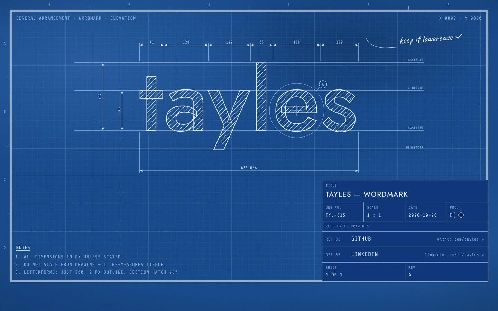

The word drawn up as an engineering sheet on cyanotype paper — outlined, section-hatched letters with guides, extension lines and dimensions measured from the real glyphs, a zoned border, and a title block whose referenced drawings are the two links.

[View it live](https://tayles.co.uk/designs/blueprint)

Fonts: Jost, Share Tech Mono and Caveat from Google Fonts. The paper grain is an inline SVG `feTurbulence` filter; no other assets.
