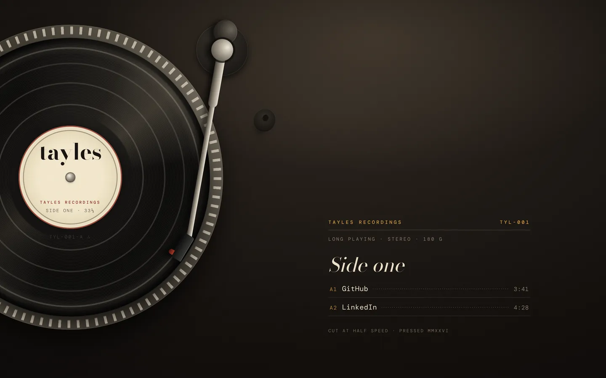

A turntable seen from directly above — a 12-inch record bleeds off the left edge with the name printed on its cream label, and the two links are the tracks on side one. Cue one and the tonearm walks in to that groove.

[View it live](https://tayles.co.uk/designs/deadwax)
