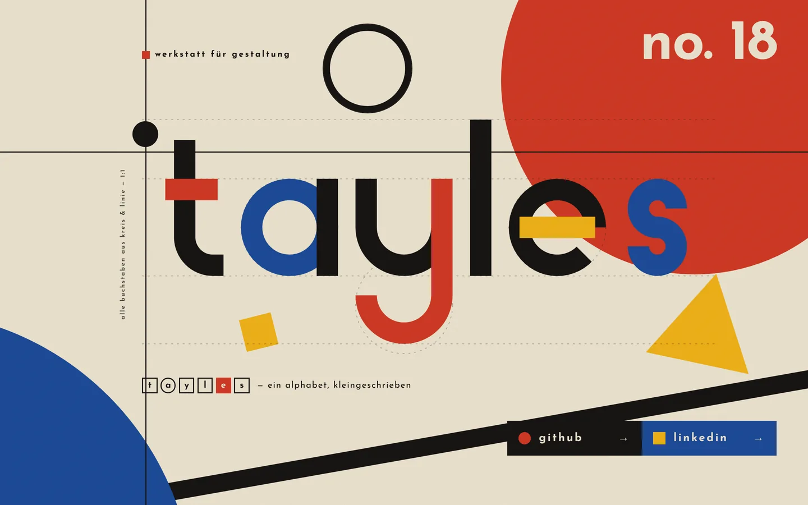

A 1920s workshop poster on cream stock — the name is constructed letter by letter from ruled lines and compass arcs in red, blue, yellow and black, drawn in like a ruling pen over its own construction lines, while primary planes hang behind it at different depths and drift with the cursor. The links are two coloured blocks of the grid.

[View it live](https://tayles.co.uk/designs/dessau)

Font: Josefin Sans (Santiago Orozco, SIL Open Font License) via Google Fonts. The letters are hand-built SVG strokes and the paper grain is an inline `feTurbulence` filter; no other assets.
