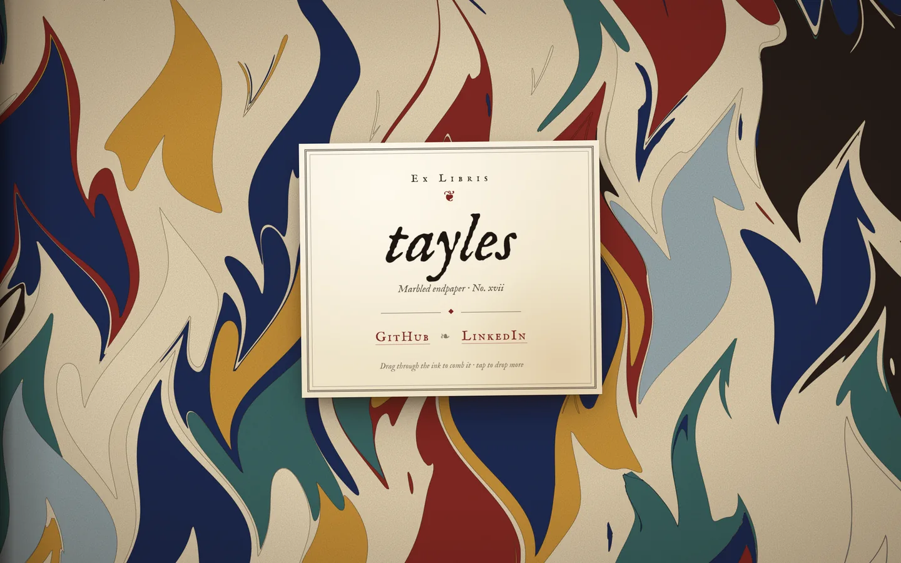

The inside cover of an old book — a sheet of hand-marbled paper in indigo, oxblood and ochre, with a printed bookplate pasted in the middle. The ink is live — drag across it to comb the colours, tap to float a new drop.

Type: IM Fell English and IM Fell English SC (Igino Marini, SIL Open Font License) via Google Fonts. The marbling is generated in the browser — no images.

[View it live](https://tayles.co.uk/designs/endpaper)
