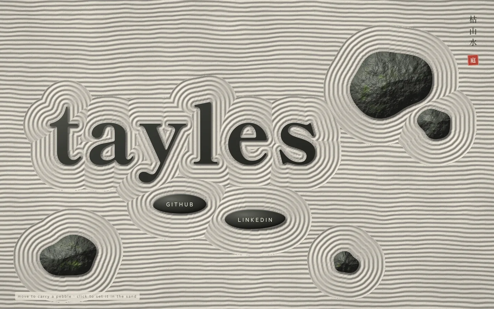

A dry Zen garden from above — straight furrows raked across pale gravel break into concentric rings around the letters of the name, two stepping-stone links and a few mossy rocks. The cursor carries a pebble the sand flows around; click to set it down.

[View it live](https://tayles.co.uk/designs/karesansui)

Fonts: Shippori Mincho B1 and Zen Kaku Gothic New from Google Fonts. The sand, rocks and pebbles are drawn by a WebGL fragment shader over a distance field traced from the page's own text and links; no other assets.
