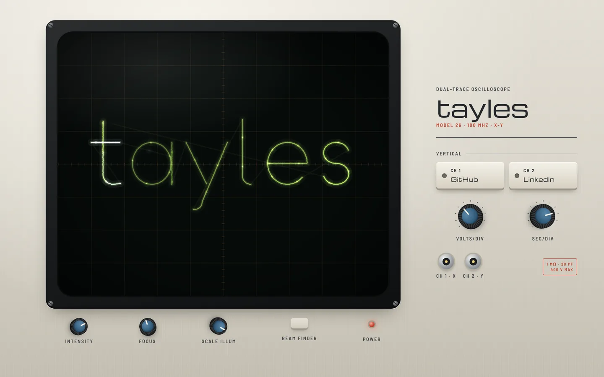

The front panel of a 1970s analogue oscilloscope in X-Y mode — the electron beam writes the name in single vector strokes, a blue-white spot trailing yellow-green afterglow across an etched graticule. Hold the cursor over the tube and it bends the trace like a magnet on the glass.

[View it live](https://tayles.co.uk/designs/phosphor)

Fonts: Michroma (Vernon Adams) and Barlow Semi Condensed (Jeremy Tribby), both SIL Open Font License, via Google Fonts. The trace is drawn on a canvas from a hand-built single-stroke vector alphabet; the panel hardware is pure CSS. No other assets.
